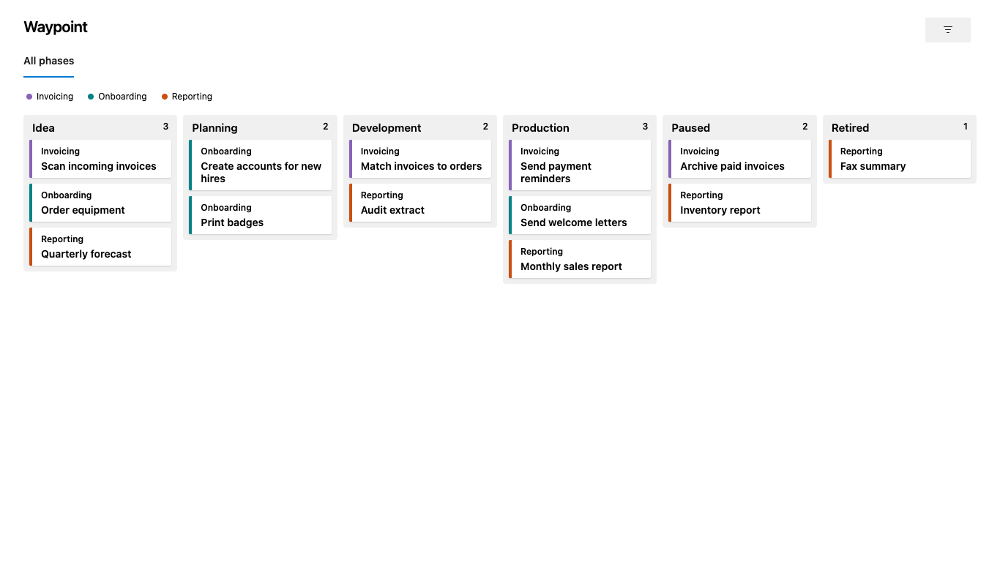

# Waypoint

**See where every work item is in its lifecycle.** Waypoint is a read-only hub for Azure Boards. It shows your work items as cards on a board with one column per phase, so anyone following the work can see what is on its way and who has to move it forward.

## Why Waypoint

Azure Boards columns follow the State field, so a long-lived lifecycle with its own phases does not fit on a regular board. Waypoint reads the phase from a picklist field of your choice and needs no extra license: it works for Stakeholders and Readers too, as long as Boards is turned on in the project.

## What you get

- **A phase board.** One column per phase, in the order you set, with the number of work items in each.
- **Tabs.** Divide long lifecycles into tabs, with a divider before any phase.
- **Cards that say what matters.** Each card shows the group's name and color, the title exactly as written, the current status on at most two lines, a highlight when it is waiting for something and a label for a flag of your choice.
- **Groups at a glance.** A list of groups above the board. Hover a group to dim all other cards.
- **Filters and shareable links.** Filter by keyword, group, picklist value, tag prefix, text prefix, or filled in or empty. The tab and filter are in the URL, so a link shows exactly the view you see.
- **Details on demand.** Click a card to read your chosen fields in a side panel and open the work item.

## Set it up

1. Install Waypoint in your organization.
2. Open **Boards → Waypoint** in a project. Until it is set up, Waypoint guesses Features under Epics and the first picklist field, and says so.
3. As a Project Administrator, open the gear to choose the work item types, the phase field and order, tabs, card fields, filters and hidden groups. Settings are saved per project.

Waypoint is for Azure DevOps Services (`dev.azure.com`). It shows up to 2,000 work items per project and tells you when there are more.

## Trust

- **One scope.** Waypoint asks only for `vso.work` and never writes to work items.
- **Your data stays in Azure DevOps.** No telemetry and no calls to any other host. See the [privacy policy](https://github.com/andersmoldin/Waypoint/blob/main/PRIVACY.md).
- **Free text stays text.** Text from work items never reaches the page as HTML: rich text fields are shown as plain text.
- **Known limitations are written down.** Everyone who can open the hub can technically read and change its settings for any project, and the settings log is unverified. Waypoint stays with one read scope rather than a broader one that could do better. Read [SECURITY.md](https://github.com/andersmoldin/Waypoint/blob/main/SECURITY.md) before you install.
- **Security reviewed.** Four independent AI reviewers went through Waypoint against OWASP ASVS 5.0 Level 1 and what is specific to Azure DevOps, and tried to break it with hostile HTML. No external human auditor has. They found no way to run code in the page. What they did find is fixed or accepted by the owner, and listed in the [security audit](https://github.com/andersmoldin/Waypoint/blob/main/SECURITY_AUDIT.md).
- **Built for WCAG 2.2 AA.** axe-core finds no violations on the board, the filter, the detail panel or the settings, with and without forced colors, and the whole hub works from the keyboard. Screen reader testing is still to come. See the [accessibility report](https://github.com/andersmoldin/Waypoint/blob/main/ACCESSIBILITY.md).
- **One person's project.** Waypoint is run by a private person, on a best-effort basis and without guarantees.

## Support

Report problems and ask questions in [GitHub Issues](https://github.com/andersmoldin/Waypoint/issues). Report vulnerabilities privately, as described in [SECURITY.md](https://github.com/andersmoldin/Waypoint/blob/main/SECURITY.md).

## License

[MIT](https://github.com/andersmoldin/Waypoint/blob/main/LICENSE).
